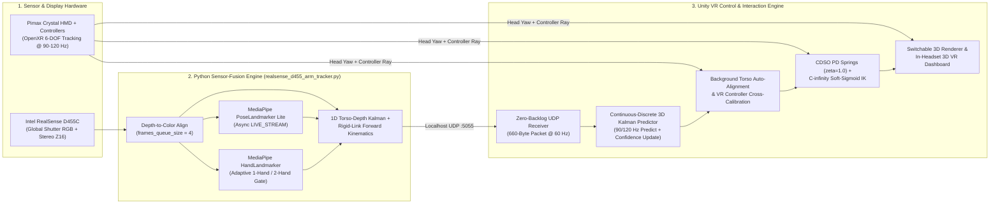

# Technical Specifications Brief: Pimax Crystal + Intel RealSense D455C VR Visuomotor Arm & Hand Illusion System (v6.0)

## 1. Executive Summary
This document summarizes the hardware-software architecture developed for real-time, jitter-free upper-limb and 21-DOF finger embodiment in Unity VR using the **Pimax Crystal HMD** and **Intel RealSense D455C Stereo Depth Camera**. Version 6.0 upgrades the pipeline with **Rigid-Link Forward Kinematics + 1D Torso-Depth Kalman Fusion**, **Continuous 90/120 Hz Kalman Prediction**, **Critically Damped Second-Order (CDSO) PD Joint Control**, **$C^\infty$ Soft-Sigmoid Anatomical Constraints**, **Background Torso Auto-Alignment**, and an **In-Headset 3D VR Dashboard with Pimax OpenXR Controller Support** across general psychophysics tasks.

---

## 2. System Architecture & Data Pipeline

---

## 3. Core Technical Subsystems

### 3.1. Rigid-Link Forward Kinematics & 1D Torso-Depth Kalman Fusion (`realsense_d455_arm_tracker.py`)
* **Elimination of Silhouette Depth Spikes:**
  * Instead of deprojecting noisy per-pixel depth patches independently at the elbow and wrist (which caused depth spikes whenever a landmark crossed the cylindrical edge of the arm during 10 cm movements), v6.0 runs a **1D Kalman Filter** (`torso_z_est`, `q = 0.0002`, `r = 0.015`) over an $11\times 11$ foreground patch at the shoulder/torso.
  * For Elbow and Wrist, D455C depth differences within $0.18\text{ m}$ of MediaPipe’s relative depth apply a gentle Huber-bounded innovation (max $\pm 0.20$ weight) to a smoothed relative depth state.
* **Continuous Metric Arm-Scale Estimation:**
  * A slow 1D Kalman Filter (`est_arm_scale`, `q = 0.00005`) tracks true upper-arm + forearm scale whenever joint visibility $> 0.65$.
* **Rigid-Link Forward Kinematics Before Velocity Updates:**
  * Extracts unit bone vectors $(\hat{\mathbf{u}}_{\text{upper}}, \hat{\mathbf{u}}_{\text{fore}})$ and reconstructs 3D Elbow and Wrist strictly along rigid link lengths $(0.28\text{ m} \cdot S, 0.25\text{ m} \cdot S)$ **before** computing velocities, eliminating bone-length clamp limit cycles.
* **Adaptive Single/Dual 21-Finger Gate:**
  * Uses `num_hands = 1` whenever only one wrist is inside the camera FOV so MediaPipe skips full-frame palm re-detection (~3 ms hand latency).

### 3.2. Continuous-Discrete 3D Kalman Predictor (`RealSenseArmReceiver.cs`, `OneEuroFilter.cs`)
* **Elimination of 30–60 Hz Sample-and-Hold Judder:**
  * `KalmanFilter3D` advances position & velocity continuously on **every 90/120 Hz Pimax VR render frame** (`Predict(dt)` with biomechanical damping $e^{-3.5 \Delta t}$).
  * When a UDP packet arrives, `UpdateMeasurement(z, confidence)` updates $(p, v)$ using adaptive covariance $R = r_0 / \text{confidence}^2$ and a smooth Huber innovation clamp.
* **Background Torso Auto-Alignment (`continuousAutoCalibration`):**
  * Locks `cameraYawOffsetDeg` and `armScale` automatically within the first ~30 valid dual-shoulder frames and tracks slow posture drift at $\le 0.5^\circ/\text{s}$, eliminating mandatory per-user manual calibration.

### 3.3. Critically Damped Second-Order (CDSO) PD Joint Controller & Soft-Sigmoid Constraints (`ArmAvatarController.cs`)
* **Closed-Form Critically Damped Spring-Dampers ($\zeta = 1.0$):**
  * Drives wrist targets, elbow swivel direction, and quaternion bone rotations via exact analytical second-order PD springs (`CriticallyDampedSpring3D`, `CriticallyDampedQuaternion`, default $f_n = 4.8\text{ Hz}$). Finite acceleration absorbs high-frequency sensor noise with **zero overshoot**.
* **$C^\infty$ Soft-Sigmoid Anatomical Constraints (`BiomechanicalMath.SoftMin/SoftMax`):**
  * Replaces discontinuous hard `if` clamps with smooth $C^\infty$ softplus barriers on posterior shoulder reach (`z >= -0.10m`), upward elbow inversion (`y <= -0.03m`), and medial chest crossing (`x * side >= -0.10m`), eliminating 13 cm boundary teleport pops.
* **Cross-Product-Free Trigonometric IK:**
  $$\mathbf{d}_{\text{elbow}} = \cos(\theta_A)\,\mathbf{d}_{\text{wrist}} + \sin(\theta_A)\,\mathbf{e}_{\perp}$$
  Guarantees mathematically that the elbow never inverts $180^\circ$ during headset adjustment or straight-arm reaches.

### 3.4. In-Headset 3D VR Dashboard & Pimax Controller Integration (`VRDashboardAndController.cs`)
* **3D World-Space VR Menu:** Renders an interactive 3D floating control panel directly inside the Pimax Crystal headset (toggleable via `A`/`X` on controllers or `Tab` on keyboard) with a 3D laser pointer ray from the active OpenXR controller (`Trigger` to click).
* **Controller-Referenced Golden Calibration (`CalibrateToVRController`):** Pressing **`Grip + Trigger`** cross-references the sub-millimeter 3D pose of the Pimax OpenXR controller with MediaPipe + D455C to align camera yaw, arm scale, and shoulder offset simultaneously.
* **Multi-Experiment Presets (`ExperimentPreset`):** Supports `GeneralFreeMovement` (shoulder-centered gain), `StrengthMachineTask` (handle-origin gain + visible target sphere), and `ProprioceptiveDriftTask`.

### 3.5. Switchable 3D Hand & Arm Representations (`ProceduralHandMeshBuilder.cs`)
Pressing **`B`/`Y`** on a VR controller (or **`M`** on keyboard) cycles live between:
1. **`MicrosoftContinuousMesh`:** Unified, dynamically skinned 3D triangle `Mesh` with 12-sided elliptical lofted rings, sculpted palmar arch, thumb thenar muscle, and 5 seamless tapered fingers in MRTK Holo-White finish.
2. **`HumanSkinContinuousMesh`:** Unified continuous 3D mesh in human skin tone.
3. **`BubbleJoints`:** High-contrast gold joint spheres and segmented phalange capsules.
4. **`CustomRiggedPrefab`:** Automatic bone mapper for imported OpenXR / Microsoft MRTK rigged hand FBX prefabs.
