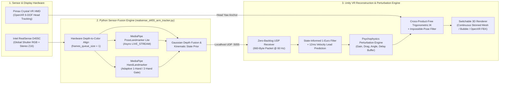

# Technical Specifications Brief: Pimax Crystal + Intel RealSense D455C VR Visuomotor Arm & Hand Illusion System (v5.0)

## 1. Executive Summary
This document summarizes the hardware-software architecture developed for real-time upper-limb and 21-DOF finger embodiment in Unity VR using the **Pimax Crystal HMD** and **Intel RealSense D455C Stereo Depth Camera**. The system is engineered specifically for **psychophysics experiments on motor agency, proprioceptive drift, and pseudo-haptic force perception** on a seated strength-testing machine, prioritizing **sub-20ms visuomotor latency**, **metric 3D accuracy**, and **anatomical plausibility**.

---

## 2. System Architecture & Data Pipeline

---

## 3. Core Technical Subsystems

### 3.1. Sensor Acquisition & Hybrid 3D Depth Fusion (`realsense_d455_arm_tracker.py`)
* **Auto-Negotiated Low-Latency Stream Profile:** Queries the D455C over USB and selects the fastest valid hardware-synchronized Depth (`Z16`) + Color (`BGR8`) profile (`640x480 @ 60 FPS` or `848x480 @ 60 FPS`), setting internal sensor queues to `frames_queue_size = 1` to eliminate frame buffering.
* **Non-Queueing Concurrent MediaPipe Inference:**
  * Runs **MediaPipe PoseLandmarker (Lite)** (`11..20` upper-body landmarks) and **MediaPipe HandLandmarker** (`0..20` 3D finger/knuckle landmarks) concurrently on background C++ threads.
  * **Adaptive Single/Dual Hand Gate:** Automatically uses `num_hands = 1` in single-arm modes (and whenever only one wrist is inside the camera FOV in Dual-Arm mode) so MediaPipe skips the heavy full-frame SSD palm detector, keeping hand inference at **~3 ms**.
* **Continuous Gaussian Depth Blending:**
  * Samples a $7 \times 7$ pixel patch around each joint and computes the **35th percentile foreground depth** (preventing background wall bleed at limb silhouettes).
  * Fuses D455C hardware metric depth ($d_{\text{sensor}}$) with MediaPipe's anatomical depth offset ($z_{\text{expected}}$) using a continuous Gaussian confidence curve ($\sigma = 0.14\text{ m}$), eliminating step-threshold discontinuities during long forward reaches.
* **Kinematic State Prior & Bone-Length Stabilization:**
  * Bounds frame-to-frame joint velocities to human biomechanical limits ($1.8\text{ m/s}$ shoulder, $4.5\text{ m/s}$ elbow, $7.0\text{ m/s}$ wrist) and projects `(Elbow - Shoulder)` and `(Wrist - Elbow)` onto running anatomical bone-length estimates ($\pm 12\%$), preventing camera foreshortening from stretching or collapsing the arm.

### 3.2. Zero-Backlog UDP Protocol & State-Informed 1€ Filtering (`RealSenseArmReceiver.cs`, `OneEuroFilter.cs`)
* **660-Byte Dual-Arm Binary Packet (`165 floats`):**
  * Streams Right Arm (`Shoulder, Elbow, Wrist, Index, Pinky`), Left Arm (`Shoulder, Elbow, Wrist, Index, Pinky`), Chest Axis (`LeftShoulder -> RightShoulder`), Right 21 Finger 3D Landmarks, Left 21 Finger 3D Landmarks, confidence metrics, and active mode flag over localhost UDP (`127.0.0.1:5055`).
  * Drains the OS UDP socket buffer (`while (_udpClient.Available > 0)`) on every read so Unity always renders the freshest frame with **zero queue latency**.
* **State-Informed 1-Euro Filter with Velocity Lead Prediction:**
  * Filters joint displacements relative to the shoulder (`e - s`, `w - s`) so torso micro-sway never shakes the hand.
  * Applies adaptive cutoff tuning (`minCutoff = 2.2 Hz`, `beta = 0.22`) combined with **12 ms Velocity Lead Prediction** (`motionPredictionMs`) to compensate for USB + rendering pipeline delay.

### 3.3. Cross-Product-Free Trigonometric IK & Impossible-Pose Filter (`ArmAvatarController.cs`)
* **Elimination of Straight-Arm & Headset-Startup Singularities:**
  * Traditional `Vector3.Cross(elbowHint, wristDir)` IK solvers suffer from $180^\circ$ sign-flip inversions when the user raises their hands to adjust their VR headset at startup or reaches straight toward the camera.
  * v5.0 replaces cross-product rotation with a **Direct Trigonometric IK Solver**:
    $$\mathbf{d}_{\text{elbow}} = \cos(\theta_A)\,\mathbf{d}_{\text{wrist}} + \sin(\theta_A)\,\mathbf{e}_{\perp}$$
    Because $\sin(\theta_A) \ge 0$ for all $\theta_A \in [0, \pi]$, the elbow is mathematically guaranteed to bend into the valid anatomical half-plane $\mathbf{e}_{\perp}$.
* **Biomechanical ROM & Headset-Holding Guard:**
  * Detects when the user's hand is raised within $28\text{ cm}$ of the Pimax HMD (putting on or adjusting the headset), blocking accidental calibration and smoothly weighting the elbow toward a natural downward-tucked posture.
  * Clamps impossible upward elbow flips (`localElbow.y > -0.02m`), medial chest penetration (`localElbow.x * sideSign < -0.10m`), posterior shoulder hyperextension, and wrist hyper-flexion ($> 70^\circ$).
* **Head-Yaw-Only Shoulder Anchoring:**
  * Locks `RightShoulderAnchor` and `LeftShoulderAnchor` to the Pimax HMD's 3D position + **horizontal yaw only**, ensuring that pitching the head downward to look at the arm in VR never pushes the virtual shoulder downward.

### 3.4. Switchable 3D Hand & Arm Representations (`ProceduralHandMeshBuilder.cs`)
Pressing **`M`** in Unity cycles live between:
1. **`MicrosoftContinuousMesh`:** A single, unified, dynamically skinned 3D triangle `Mesh` (`ContinuousHandArmMesh`) featuring 12-sided elliptical lofted cross-sections from the deltoid/bicep through the forearm, a sculpted palmar arch with thumb thenar eminence, and 5 seamless tapered fingers with closed rounded fingertips in a sleek MRTK Holo-White metallic finish.
2. **`HumanSkinContinuousMesh`:** The same continuous, joint-seamless 3D organic hand & arm mesh rendered with a warm human skin material.
3. **`BubbleJoints`:** High-contrast kinematic visualization with gold joint spheres and segmented phalange capsules.
4. **`CustomRiggedPrefab`:** Automatic bone-mapper (`AutoMapCustomHandBones`) that drives imported **Microsoft MRTK / OpenXR (`com.unity.xr.hands`)** rigged hand FBX prefabs.

### 3.5. Psychophysics Perturbation Engine & Persistent Memory
* **Real-Time Experimental Perturbations:**
  * `movementGain` ($0.2\times - 2.5\times$): Scales visual reach displacement from the calibrated strength-machine handle origin (`CalibratedHandleOrigin`) to induce pseudo-haptic heavy/light load illusions.
  * `pseudoHapticDrag` ($0 - 20$): Viscous lag proportional to force/speed changes.
  * `elbowFlexionOffsetDeg` ($\pm 45^\circ$): Angular perturbation around the elbow hinge axis for proprioceptive drift trials.
  * `artificialDelayMs` ($0 - 300\text{ ms}$): Ring-buffer temporal delay injection for sense-of-agency breakdown experiments.
* **Persistent Session Memory:** Automatically saves and restores all calibrated parameters (`armScale`, `cameraYawOffsetDeg`, `shoulderOffsetFromHead`, filter settings, active arm mode, and 3D mesh style) via Unity `PlayerPrefs`.

